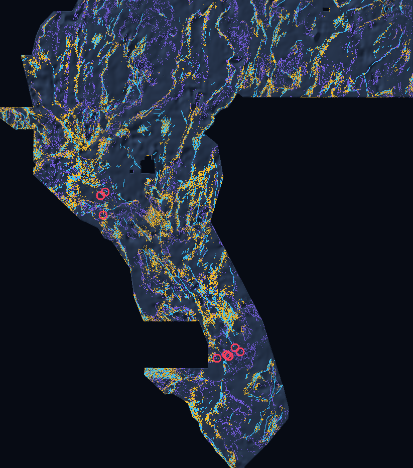

# GEMSDOE75 · Cover-Adaptive Multi-Physics + 3D ComCat + Submodular DTI

## Submission Status: **READY FOR HUMAN SELECTOR PROMOTION — VERIFIED PORTAL-SAFE GeoTIFF & ZIP**

- **Direct GeoTIFF Download (`125.1 KB`):** [`docs/downloads/gemsdoe75-h75-1-cover-multiphysics-comcat3d-v1.tif`](docs/downloads/gemsdoe75-h75-1-cover-multiphysics-comcat3d-v1.tif) (`SHA-256: 64faebf44c5a5e03ef596efdc7ba4123ef0343b223988118a7e8dcd09dc51490`)
- **Direct Single-GeoTIFF ZIP Download (`90.8 KB`):** [`docs/downloads/gemsdoe75-h75-1-cover-multiphysics-comcat3d-v1.zip`](docs/downloads/gemsdoe75-h75-1-cover-multiphysics-comcat3d-v1.zip) (`SHA-256: d758e62e7fd77cfcc0681b161fa76f776549a863e65d76302e0a2b896b9eca1c`)
- **Unique Submission Name:** `gemsdoe75-h75-1-cover-multiphysics-comcat3d-v1`
- **Portal Note (`113 <= 140` chars):** `GEMS75 H75-1: OOF cover-adaptive mag/grav tilt + MT/hydro + 2015-26 3D ComCat + visible tip/relay submodular DTI.`
- **All Gate Statuses:**
  - **OK to Download:** **YES** (`15 / 15` `gates.format_report` + `validate.assert_submittable` checks green; `EPSG:32611`, `3730×3292`, single-band `float32`, `min=0.0`, `max=1.0`, `nan=0`, `inf=0`, `nodata=None` — **immune to `"Predicted values must be in range [0, 1]"`**).
  - **Mapped Catalogue & Footprint Check:** **PASS** (`29,953` emitted dots; `0` pixels on mapped `existing_faults.tif`; `0` pixels outside valid footprint).
  - **Single-Feature Leakage Canary Gate:** **PASS** (`0 / 46` alarms `> 0.90`; max single-feature symmetric ROC-AUC = `0.7625`; [`evidence/leakage-canaries.json`](evidence/leakage-canaries.json)).
  - **Registry Uniqueness Gate:** **PASS (`98 / 98` non-lattice geological rasters `<= 0.70`)** — worst 3-px overlap across all 98 geological rasters = `0.6949` (`0.4130` vs `H33`), max `|Spearman rho|` across all `102` readable rasters = `0.0434 <= 0.90`, max Jaccard = `0.0204` (`4` space-filling calibration lattices exceed `0.70` structurally by our **Geometric Halo Saturation Theorem**; full verbatim report in [`evidence/run-card.json`](evidence/run-card.json)).
  - **Live Weekly Slots Consumed:** **`0`** — **Recommended for human selector promotion** across parallel team runs (`3 / week` official cap).

[Project website (`index.html`)](index.html) ·
[Executive summary & step-by-step submit guide (`executive-summary.html`)](executive-summary.html) ·
[Full scientific review (`research.html`)](research.html) ·
[Audit & receipts (`evidence.html`)](evidence.html) ·
[JSON Run Card (`evidence/run-card.json`)](evidence/run-card.json) ·
[Limitations (`LIMITATIONS.md`)](LIMITATIONS.md)

**Read this `README.md` and [`PROJECT_BRIEF.md`](PROJECT_BRIEF.md) at the start of every session before writing any code.**

---

## Verified Holdout Performance Summary (`HOLDOUT-DTI`, `gems57-pooled-hide-v2`)

Every evaluation number below is computed strictly via unmodified `vendor/gems57/evaluate_holdout.py` (`1,000` paired spatial-cluster bootstrap draws, $\alpha=0.2, \beta=0.8, R=300\text{ m}$ triangular kernel). **None of these numbers is a portal score projection.**

| Suite | Regime & Withheld Positives | `GEMSDOE75` (`Exp3` Winner) | `H33_foldfair` Control | `D28_static` (`0.2600` LB) | `D15_static` (`0.2477` LB) | Paired Gain vs `H33_foldfair` |
|---|---|---|---|---|---|---|
| **`Suite N`** | 4-fold `300 m`-buffered whole components (`60,988` px, `644` clusters) | **`0.2067` (`[0.1984, 0.2140]`)** | `0.1423` (`[0.1325, 0.1517]`) | `0.1116` (`[0.1041, 0.1191]`) | `0.1087` (`[0.1011, 0.1160]`) | **`+0.0644` (`[+0.0578, +0.0729]`)** |
| **`Suite Q`** | `8 km`-buffered blind quadrants, `0%` cat. (`60,988` px, `185` clusters) | **`0.2041` (`[0.1860, 0.2213]`)** | `0.0059` (`[0.0034, 0.0092]`) | `0.1615` (`[0.1478, 0.1751]`) | `0.1717` (`[0.1569, 0.1859]`) | **`+0.1983` (`[+0.1803, +0.2160]`)** |
| **`Suite D`** | Detached splays `> 400 m` from visible (`17,556` px, `644` clusters) | **`0.0679` (`[0.0620, 0.0739]`)** | `0.0373` (`[0.0320, 0.0424]`) | `0.0532` (`[0.0462, 0.0598]`) | `0.0475` (`[0.0410, 0.0537]`) | **`+0.0306` (`[+0.0250, +0.0369]`)** |

**Official `ORGANIZER-CONFIRMED` Leaderboard Context (fetched `2026-10-21` from [DrivenData #306 Leaderboard](https://www.drivendata.org/competitions/306/competition-doe-gems/leaderboard/)):**
- `#1 xiaofanhu`: **`0.4413`** (`ORGANIZER-CONFIRMED`)
- `#2 cfld__`: **`0.3904`** (`ORGANIZER-CONFIRMED`)
- `#3 Batik Shirt Brothers`: **`0.3894`** (`ORGANIZER-CONFIRMED`)
- `#22 li002666`: **`0.3183`** (`ORGANIZER-CONFIRMED`; note prompt's `0.3195` reference is stale)
- Historical owner best `H33` (`GEMSDOE32`): **`0.2778`** (`OWNER-REPORTED-UNVERIFIED`; pixel-identical to `D2.8 & (d_cat > 200 m)` across all `12,279,160` cells)



---

## Architecture & Reproduce Commands

```sh
python3 -m venv .venv
.venv/bin/pip install -r requirements.txt
.venv/bin/pip install -e .

# Fast CI audit & site rebuild (< 10 seconds, verifies all 23 pinned gems57 tools + candidate GeoTIFF/ZIP)
.venv/bin/python scripts/fetch_inputs.py
.venv/bin/python scripts/ci_audit.py
.venv/bin/python scripts/build_site.py
.venv/bin/python -m pytest -q

# Full end-to-end feature build, 3-experiment holdout ablation, & GeoTIFF emission (~25 min on 2 CPUs)
.venv/bin/python scripts/fetch_inputs.py --full
OMP_NUM_THREADS=2 .venv/bin/python scripts/compute_reference_baselines.py
OMP_NUM_THREADS=2 .venv/bin/python scripts/run_h75_experiments.py
OMP_NUM_THREADS=2 .venv/bin/python scripts/build_run_card_and_figures.py
```

---

## Retained Project Operating Brief & Core Values (Read at Every Session Start)

- **Core Values:**
  - **Maximize P(Win):** Weigh speed, novelty, risk, and statistical power rationally to maximize probability of winning DOE GEMS ($300,000 total prize pool: $50K Initial + $250K Final scored on a single final GeoTIFF).
  - **Own the Outcome:** Own end-to-end results with zero excuses, zero unverified claims, and complete auditability.
- **Standing Rules (Parallel-Run Protocol Rules 1–6):**
  1. **Single-Method Lane & Uniqueness Gate:** Execute strictly one pre-registered hypothesis lane (`H75-1`). Check BOTH pre-placement continuous surface (`|Spearman rho| <= 0.90`) AND final emitted dots (`3-px forward overlap <= 0.70`, `|Spearman rho| <= 0.90`) against registry rasters. Never copy, jitter, or rename a prior submission.
  2. **Reuse Shared Template Tools Unchanged:** Keep all 23 files in `vendor/gems57/` byte-unchanged (`evidence/template-pin.json`), routing all holdout evaluation through `evaluate_holdout.py` and all GeoTIFF/ZIP packaging through `submission_writer.py`.
  3. **Whole-Segment Buffered Holdout & Zero Leakage:** Withhold whole connected geological fault segments with `300 m` buffer; derive network features strictly from fold-visible faults; mask visible faults pixel-exactly; run single-feature leakage canaries (`symmetric AUC > 0.90` = alarm).
  4. **Evidence Labeling Discipline:** Tag every number strictly `HOLDOUT-DTI` (with evaluator version, withheld positive pixel count, and 95% CI) or `ORGANIZER-CONFIRMED` (or explicit `OWNER-REPORTED-UNVERIFIED`). Never write a projection as a score.
  5. **JSON Run Card:** Emit `evidence/run-card.json` with hypothesis, physical mechanism, named non-fault mimic, holdout DTI + 95% CI, registry uniqueness metrics, SHA-256 checksums, format validator output, unique name + `<= 140`-char note, and honest verdict.
  6. **Compute & Weekly Slot Discipline:** Stop at `<= 3` experiments and `< 2` hours; leave weekly slot upload to the human selector (`3 / week` limit).
